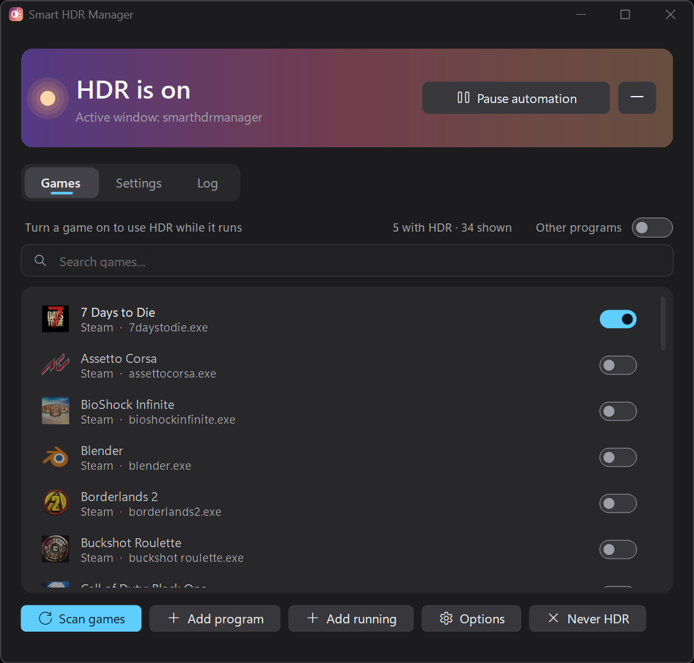
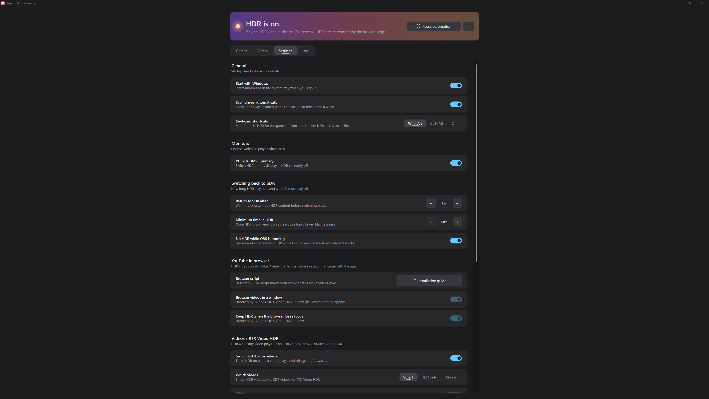
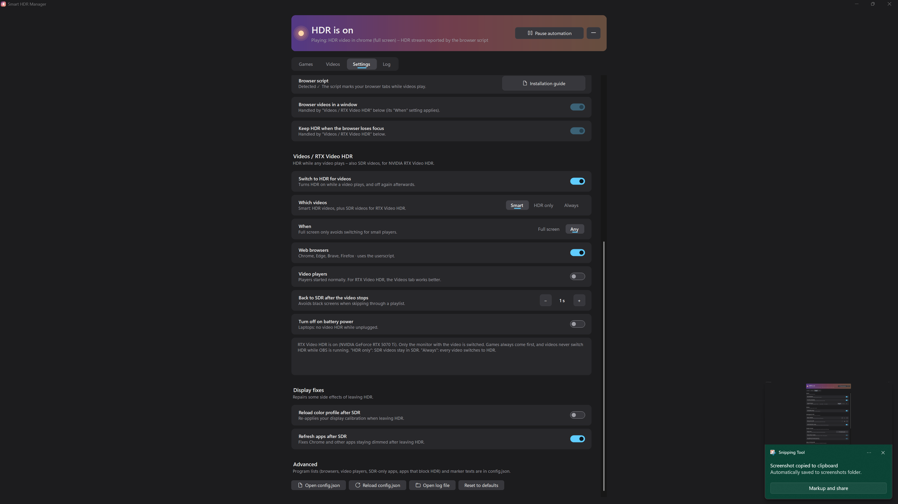
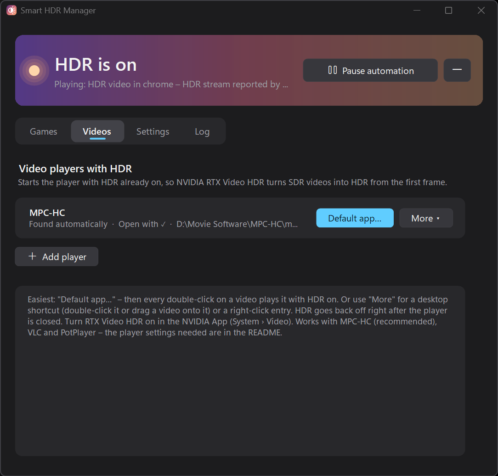

# Smart HDR Manager

Turns Windows HDR on automatically when you need it – HDR games, HDR videos on YouTube, local videos in your video player (including SDR videos with NVIDIA RTX Video HDR) – and back to SDR when you are done. It lives in the system tray.

**New in 2.5.1:** Videos tab (double-click any video and it plays with HDR – made for RTX Video HDR), *Launch with HDR* for games, *No HDR while OBS is running*, Ubisoft / EA / Rockstar games, a tidier Settings page and many fixes. See [CHANGELOG.md](CHANGELOG.md).

   

> **Beta.** Tested on Windows 11 25H2 with an NVIDIA GeForce RTX 5070 Ti and one HDR monitor (ASUS PG32UCDMR); RTX Video HDR tested with MPC-HC, VLC and PotPlayer.
> Not tested yet: AMD and Intel graphics, Windows on ARM (Snapdragon), Windows 10 / Windows 11 24H2 and older, several HDR monitors, laptops.
> If something does not work on your PC, please report it (see *Reporting a problem*).

   ☕ **Like the app?** You can support development on [Ko-fi](https://ko-fi.com/vantacode420).

---

## Download – which file?

| File | Size | Use it if … |
|---|---|---|
| `SmartHdrManager-v…-win-x64-standalone.zip` | large | **You are not sure.** Runs on any 64-bit Windows 10/11, nothing else to install. |
| `SmartHdrManager-v…-win-x64.zip` | small | You already have the **.NET 10 Desktop Runtime** installed ([download](https://dotnet.microsoft.com/download/dotnet/10.0) → ".NET Desktop Runtime", x64). |
| `SmartHdrManager-v…-win-arm64-standalone.zip` | large | *Experimental, untested.* Windows on ARM (e.g. Snapdragon X laptops), nothing else to install. |
| `SmartHdrManager-v…-win-arm64.zip` | small | *Experimental, untested.* Windows on ARM with the .NET 10 Desktop Runtime **Arm64** installed. |

Not sure if your PC is ARM? *Settings › System › About › System type* says "ARM-based processor" on ARM PCs – everyone else takes x64.

Requirements: Windows 10 or 11 (64-bit) and an HDR-capable monitor with HDR available in *Windows Settings › Display*.

## Installation

1. Unzip to a permanent folder, e.g. `C:\Tools\Smart HDR Manager`. (Don't run it from inside the zip or from Downloads – "Start with Windows" remembers the location.)
2. Start `SmartHdrManager.exe`.
3. **"Windows protected your PC"?** The app is not code-signed (signing costs money every year), so Windows does not know it yet. Click **More info › Run anyway**. You can check the file first: compare it with `SHA256SUMS.txt` from the release, or look at the VirusTotal link in the release notes.
4. Optional: in **Settings**, turn on **Start with Windows**.

**Updating from an older version:** exit the app (tray icon › Exit), replace the files in your folder with the new ones and start it again. Your settings and game list are kept. (If you unzip to a new folder instead, start the new exe once – "Start with Windows" and the Videos tab entries are moved to it automatically.)

Settings are stored in `%AppData%\SmartHdrManager\config.json`, the log in `%LocalAppData%\SmartHdrManager\log.txt` (the older part moves to `log.old.txt`, both stay small).
**Portable mode:** put an empty file named `portable.txt` next to the exe, and the settings are kept in that folder instead.

## How it works

| HDR turns on when … | How it is detected |
|---|---|
| A game from your list is running | Games tab: games from Steam, Epic, GOG, Xbox, Ubisoft Connect, EA app and Rockstar are found automatically – switch HDR on per game. |
| A real HDR video plays on YouTube | The browser script marks the tab (see below). |
| A local HDR movie plays full screen | Video player (VLC, mpv, mpv.net, MPC-HC, MPC-BE, PotPlayer) + "HDR", "Dolby Vision", "DoVi" or "BT2020" in the window title. |
| A video is opened with "<Player> (with HDR)" | **Videos** tab: HDR switches on *before* the player starts – best for RTX Video HDR (see below). |
| *(optional)* Any video plays – for **RTX Video HDR** | Settings › Videos / RTX Video HDR. Browsers via the script, video players while they play. |

When the content ends, the app waits a few seconds (Settings › *Return to SDR after*) and switches back to SDR.

**Games tab:** **Scan games** re-reads the game libraries and your drives. **Add program** / **Add running** adds any other program. **Options** sets a per-game delay before HDR (for games that crash or flicker if HDR switches during startup), how long HDR stays on after the game closes, and **Launch with HDR** (see below). **Never HDR** removes a game for good.

**Tray menu:** open the window, pause automation, **HDR override** (force HDR on or SDR for a while), exit.

**Keyboard shortcuts** (Settings › Keyboard shortcuts – Win+Alt, Ctrl+Alt or off):
`+ H` use HDR for the game in front · `+ I` never HDR for it · `+ O` override: HDR on → SDR → automatic.

**Command line** (for Stream Deck buttons, shortcuts or scripts – a second launch only passes the command to the running app):
```
SmartHdrManager.exe --force-hdr      HDR on until changed back
SmartHdrManager.exe --force-sdr      SDR until changed back
SmartHdrManager.exe --auto           back to automatic switching
SmartHdrManager.exe --toggle-pause   pause / resume automation
SmartHdrManager.exe --tray           start hidden in the tray
SmartHdrManager.exe --launch "C:\Games\Game\game.exe"   HDR on first, then start the game (see below)
SmartHdrManager.exe --launch-video "C:\...\mpc-hc64.exe" "movie.mkv"   same for a video player (ends when its window closes)
```

**No HDR while OBS is running** (Settings › Switching back to SDR): while OBS is open, nothing switches HDR on automatically – games included – and HDR goes back to SDR the moment OBS starts, so you never record blown-out HDR footage by accident. A manual override still works.

### Launch with HDR

Some games only check whether Windows HDR is on at the moment they start, and hide their HDR option otherwise (or Windows Auto HDR does not kick in). Switching HDR when the game process appears is too late for them – you had to restart the game. **Launch with HDR** turns HDR on first, waits until it is really on, then starts the game, and keeps HDR on until the game closes.

- **Steam:** Games tab › select the game › **Options › Copy Steam launch option**, then in Steam: right-click the game › *Properties › General › Launch options* › paste. It looks like `"C:\Tools\Smart HDR Manager\SmartHdrManager.exe" --launch %command%`.
- **Other games:** **Options › Create HDR desktop shortcut** puts a "<Game> (HDR)" shortcut on your desktop.
- If you move the app folder, copy the launch option / create the shortcut again.
- The program to start only ever comes from the shortcut or launch option itself – the running app never receives a path from anywhere else.

<p>
  
  
</p>

## RTX Video HDR (NVIDIA RTX graphics cards)

NVIDIA RTX Video HDR turns SDR videos into HDR – but only while Windows HDR is on. First switch it on in the **NVIDIA App › System › Video › RTX Video Enhancements › HDR** (Super Resolution there is optional). The app only *reads* this setting; it never changes driver settings.

### Local videos: use the Videos tab (recommended)

Video players decide when playback starts whether they output HDR. If Windows switches to HDR a moment later, RTX Video HDR does not kick in for SDR videos. The **Videos** tab solves that by switching HDR on *before* the player starts. It lists your installed players (MPC-HC, MPC-BE, VLC, PotPlayer, mpv.net, Kodi – or add any other) and offers

- **Default app…** (easiest): registers "<Player> (with HDR)" as an app for video files and opens *Settings › Default apps*, where you click **Set default** once. From then on, every double-click on a video plays it with HDR on. (Windows does not let programs set themselves as default – that one click is yours. Alternative: right-click a video › *Open with* › *Choose another app* › "<Player> (with HDR)" › *Always*.)
- **More › Create desktop shortcut** "<Player> (HDR)": double-click it or drag a video onto it.
- **More › Add right-click entry** "Play with HDR (<Player>)" for video files (Windows 11: *Show more options*).

All of them switch HDR on first, wait until it is really on, start the player, and switch back to SDR about a second after the player window is closed. No administrator rights are needed.



### Player settings for RTX Video HDR

The player must also use a video output that supports RTX Video HDR. Tested:

| Player | RTX Video HDR | |
|---|---|---|
| **MPC-HC** | ✅ works | **recommended** |
| VLC | ✅ works | |
| PotPlayer | ✅ works | |
| MPC-BE | should work (same renderer as MPC-HC) | not tested |
| Kodi | ❌ no RTX Video HDR | HDR switching still works for real HDR videos |

**MPC-HC (recommended)**
1. *View › Options › Playback › Output* › **Video Renderer: MPC Video Renderer**.
2. Click **Properties** next to it (or right-click the video while playing › *Filters › MPC Video Renderer*):
   - ✅ **Use Direct3D 11**
   - ✅ **RTX Video HDR** (section *DXVA2 and D3D11 video processor*)
   - optional: *Request Super Resolution* (e.g. "for ≤ 1440p")
3. OK, then restart MPC-HC.

**VLC**
1. *Tools › Preferences* › bottom left: **Show settings: All**.
2. *Video › Output modules* › **Direct3D11**:
   - **HDR Output Mode: Generate HDR from SDR**
   - optional: *Video Upscaling Mode: Super Resolution*
3. **Save**, then restart VLC.

**PotPlayer**
1. Right-click › *Preferences* (F5) › **Video**.
2. **Video renderer: Built-in Direct3D 11 Video Renderer**.
3. ✅ **D3D11 GPU RTX Video HDR**, optional: ✅ *D3D11 GPU Super Resolution*.
4. OK, then restart PotPlayer.

### Automatic video switching (browsers and players)

With **Settings › Videos / RTX Video HDR › Switch to HDR for videos**, the app turns HDR on while a video plays – this is how browser videos (YouTube & co., via the browser script) get RTX Video HDR:

- **Smart** – HDR videos, plus SDR videos when RTX Video HDR is switched on in the NVIDIA App.
- **HDR only** – only real HDR videos. **Always** – every video.
- **When:** *Full screen* (recommended) or *Any* (also windowed).
- **Video players:** detects players started normally. For RTX Video HDR in players, the Videos tab works better (see above) – if you use it, you can turn this switch off.
- Only the monitor that shows the video is switched (it must be enabled under Settings › Monitors).
- Games always come first. While **OBS** is running, videos never switch HDR (it would disturb a recording) – turn on *No HDR while OBS is running* to keep games in SDR too. On battery power it is off unless you change that.
- **Kodi** (automatic mode): it does not show the file name in its window title, so the app cannot tell HDR from SDR – use *Which videos: Always*. It reacts while Kodi plays sound, so music in full-screen Kodi switches too. Other players: add their process name to `LocalVideoPlayers` in config.json.

---

## Browser script (needed for YouTube HDR and browser videos)

The file `SmartHdrManager_YouTube.user.js` is a small Tampermonkey script. While a video plays, it adds a marker to the tab title:
` [real_hdr_active]` for real HDR YouTube videos, ` [sdr_video_active]` for other videos. Smart HDR Manager reacts to that marker.

On YouTube it also makes the site offer the HDR version of a video while Windows is still in SDR. On other sites it only adds the marker – it reads nothing, sends nothing and changes nothing else. It runs on all sites so that videos on any site can be detected.

### Chrome, Brave, Opera, Vivaldi

1. **Install Tampermonkey** from the Chrome Web Store: <https://chromewebstore.google.com/detail/tampermonkey/dhdgffkkebhmkfjojejmpbldmpobfkfo> → **Add to Chrome** → **Add extension**.
2. **Allow user scripts** (required since Chrome 138 – without it, no script runs):
   - Open `chrome://extensions` (Brave: `brave://extensions`, Opera: `opera://extensions`, Vivaldi: `vivaldi://extensions`).
   - Click **Details** under Tampermonkey.
   - Turn on **Allow User Scripts**.
   - *Don't see that switch?* Your browser is older: turn on **Developer mode** (top right of the extensions page) instead.
3. **Add the script:**
   - Click the puzzle icon in the toolbar → **Tampermonkey** → **Create a new script…**
   - In the editor, select everything (**Ctrl+A**) and delete it.
   - Open `SmartHdrManager_YouTube.user.js` with Notepad, copy everything (**Ctrl+A**, **Ctrl+C**) and paste it into the editor (**Ctrl+V**).
   - Press **Ctrl+S** to save. The script now appears as *enabled* in the Tampermonkey dashboard.
4. **Reload** tabs that were already open (or restart the browser).

### Microsoft Edge

1. Install Tampermonkey from the Edge Add-ons store: <https://microsoftedge.microsoft.com/addons/detail/tampermonkey/iikmkjmpaadaobahmlepeloendndfphd> → **Get**.
2. Open `edge://extensions`, click **Details** under Tampermonkey and turn on **Allow User Scripts**. If there is no such switch, turn on **Developer mode** (left side of the extensions page).
3. Add the script as in step 3 above, then reload open tabs.

### Check that it works

Settings › YouTube in browser shows **Browser script: Detected ✓** once the app has seen the marker. Or open any YouTube video and hover over the browser tab: the title ends with **[sdr_video_active]** while it plays, or **[real_hdr_active]** for an HDR video (search YouTube for "4K HDR"). No marker? Check that the script is enabled in the Tampermonkey dashboard and that *Allow User Scripts* / *Developer mode* is on.

**Updating the script:** open the Tampermonkey dashboard, click the script, replace its text with the new file and save.

---

## Safety and privacy

- No internet connection, no telemetry, no ads. Everything stays on your PC.
- **Anti-cheat safe:** the app never reads or changes game memory and injects nothing. It only reads process names and window titles, like Task Manager does.
- Some antivirus programs may be suspicious of an unsigned tray app that watches running programs and has global keyboard shortcuts. The release notes link a VirusTotal scan of exactly these files.
- **Can the browser script make the app run code?** No. The script only changes the tab title; the app only checks whether a window title *contains* the marker text. Nothing from a title is executed or written anywhere. Any website can set any tab title anyway, so the worst a malicious script or site could do is switch HDR on. The app itself only ever starts Notepad (when you click *Open config.json / log file*), a fixed Windows colour-profile task (off by default), itself (*Start with Windows*) and – with *Launch with HDR* / the Videos tab – the game or player named in your own shortcut, Steam launch option, right-click entry or "(with HDR)" app.
- **Note:** a website can read its own tab title, so in theory it could notice the marker while a video plays and tell that the script is installed. Nothing else is exposed.

## Known limitations

- RTX Video HDR status is read only; the app cannot switch it.
- Video players are detected by their audio output. A video file without an audio track is not detected in "RTX Video HDR" mode.
- On sites other than YouTube, every video counts as SDR (HDR can't be detected reliably there).
- Netflix, Disney+ and Apple TV are not supported yet.
- Kodi has no RTX Video HDR (HDR switching works for real HDR videos).
- HDR switching takes 1–2 seconds and the screen may go black briefly – that's Windows/the monitor, not the app.

## Troubleshooting

- **HDR does not turn on:** look at the **Log** tab – every decision is written there. Check *Settings › Monitors* (is your HDR monitor enabled?).
- **Colours look wrong after HDR:** the log shows a `COLOR` line after every switch back to SDR, comparing the display before and after. A reset calibration / night-light curve is restored automatically.
- **A game crashes or flickers at start:** Games tab › Options › *Delay before HDR turns on* = 3–5 s.
- **A game hides its HDR option / needs a restart to show HDR:** use **Launch with HDR** (Games tab › Options).
- **A game switches HDR itself (its own HDR option):** the app notices and keeps HDR on until the game closes – the log says "switched HDR on itself". Adding the game to your list works too.
- **RTX Video HDR does not kick in for local videos:** start the player through the Videos tab, and check the player settings above.
- **Several monitors:** by default only the primary monitor is switched. If a game runs on another screen, the log shows a `HINT` line – select that monitor in Settings › Monitors.
- Program lists (browsers, video players, SDR-only apps, apps that block video HDR) can be edited in `config.json` (Settings › Open config.json, then *Reload config.json*).

## Reporting a problem

Please include: Windows version, graphics card, monitor, what you did, what happened – and the log file (Settings › **Open log file**, or `%LocalAppData%\SmartHdrManager\log.txt`).

## Uninstall

1. Settings › turn off **Start with Windows** (removes the startup entry).
2. Exit the app (tray icon › Exit) and delete its folder.
3. Optional: delete `%AppData%\SmartHdrManager` (settings) and `%LocalAppData%\SmartHdrManager` (log).
4. In the browser: remove the script in the Tampermonkey dashboard.
5. If you used the Videos tab: remove "(with HDR)" apps and right-click entries there first (More menu). Otherwise Windows keeps showing them; they live under `HKEY_CURRENT_USER\Software\Classes` (`SmartHdrManager.HdrPlay.*`, `SystemFileAssociations\<.ext>\shell\SmartHdrManager.*`) and `HKEY_CURRENT_USER\Software\SmartHdrManager`.

## License

MIT – see `LICENSE.txt`.
